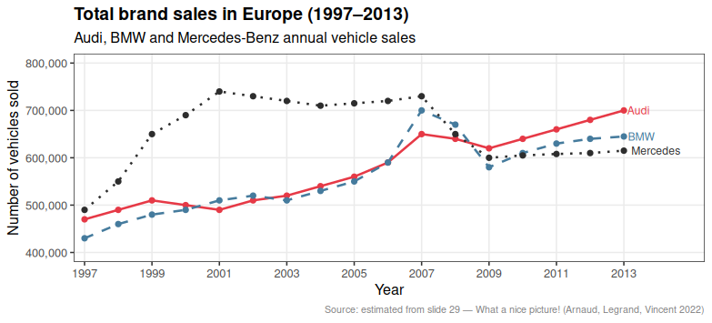
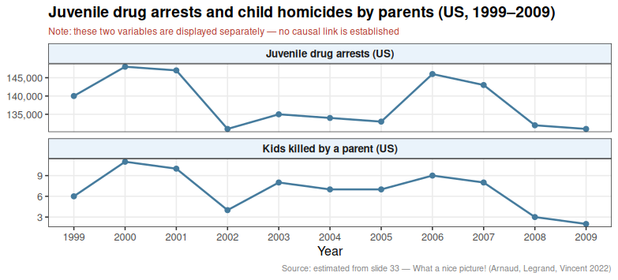
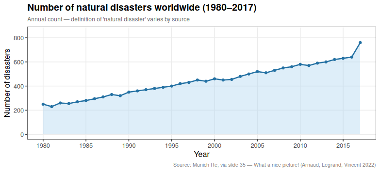

# Critical Analysis of 3 Figures from "What a Nice Picture!" Slides

<small>NB: Since no dataset was provided, I estimated the values directly from the figures and implemented them in CSV files.</small>

---

## Figure 1 — Slide 29: Total Brand Sales in Europe (Audi / BMW / Mercedes-Benz)

### What is good
- The chart type (line chart) is appropriate for temporal data with continuous evolution.
- The three brands are distinguishable by color.
- The y-axis has explicit numeric values and a consistent scale.
- The x-axis covers a meaningful time range (1997–2013).
- A title is present and self-contained.
- The number of curves is small (3), which respects the readability limit.

### Checklist violations

| Category | Issue |
|---|---|
| **Data** | No confidence intervals or error bars shown |
| **Graphical objects** | Colors are not distinguishable in B/W — red, blue, black are similar when printed grayscale |
| **Graphical objects** | No grid to help reading precise values |
| **Annotations** | Y-axis has no unit label (number of vehicles? units?) |
| **Annotations** | Legend is placed in a separate box far from the curves — direct labeling would be better |
| **Information** | No source cited for the data |
| **Context** | No caption or text commenting the figure |

### Corrected figure

### What was corrected
- Added y-axis label with unit (number of vehicles sold)
- Added grid for readability
- Added direct curve labels (end of curve) instead of a legend box
- Used colorblind-friendly palette + distinct line types (solid, dashed, dotted) for B/W compatibility
- Added data source annotation
- Removed chartjunk (unnecessary border around legend)

---

## Figure 2 — Slide 33: Juvenile Drug Arrests vs. Kids Killed by Parent (US)

### What is good
- The time range is clearly indicated on the x-axis.
- The two series are visually distinct (color + marker shape).
- The source is cited.

### Checklist violations

| Category | Issue |
|---|---|
| **Data** | Dual y-axis used: two completely different scales on the same graph. This is misleading — it visually suggests correlation between two unrelated variables |
| **Data** | No confidence intervals shown |
| **Graphical objects** | The dual axis makes curves cross in a way that implies a relationship that may not exist |
| **Annotations** | The two y-axes have different units (arrests vs. deaths) — a reader can easily misread the scale |
| **Information** | The number of kids killed is a very small number (2–12) while arrests are in the 130,000s — putting them on the same graph without careful framing is misleading |
| **Context** | No title on the original graph |
| **Context** | The juxtaposition of these two variables implies a causal link that is not established — this is a classic spurious correlation trap |

### Corrected figure

### What was corrected
- Removed the dual y-axis entirely
- Split into two separate panels (facets) with their own independent y-axis
- Each panel has a clear title and unit
- Added a note warning that correlation between these variables is not established
- Added a proper overall title

---

## Figure 3 — Slide 35: Evolution of Natural Disasters Worldwide (1980–2017)

### What is good
- The time range is clearly indicated.
- The trend is visible.
- The source is cited (Munich Re).

### Checklist violations

| Category | Issue |
|---|---|
| **Data** | No confidence intervals or uncertainty bands shown — the count of "natural disasters" depends heavily on the definition used |
| **Graphical objects** | Dark colored background (navy blue) reduces readability, especially for B/W printing |
| **Graphical objects** | No grid — hard to read precise values |
| **Annotations** | Y-axis has no label and no unit |
| **Annotations** | X-axis only shows round decade ticks (1980, 1990, 2000, 2010) — intermediate years missing |
| **Annotations** | Origin is not 0 — the y-axis starts around 200, which exaggerates the apparent growth |
| **Context** | No definition of what counts as a "natural disaster" in the title or caption |
| **Context** | The title is in French (ÉVOLUTION DU NOMBRE…) while the rest of the course is in English — inconsistency |

### Corrected figure

### What was corrected
- Removed colored background — white background for clarity
- Added proper y-axis label with unit
- Set y-axis origin to 0 to avoid visual exaggeration
- Added annual x-axis ticks
- Added grid
- Added a caption explaining the data source and the definition caveat
- Used a neutral color for the line with a subtle fill below it to show the trend