# M2R-ParallelQuicksort — Performance Evaluation

This project evaluates the performance of three sorting implementations:

- **Sequential quicksort** — standard recursive quicksort
- **Parallel quicksort** — multi-threaded version using Pthreads (`THREAD_LEVEL = 10`)
- **Built-in libc qsort** — C standard library reference

The original code was written by Joshua Stough (Washington and Lee University) and later adapted by Arnaud Legrand for performance evaluation purposes. The original experiment was conducted in 2014 on an Intel Core i7 running Debian/Linux 3.14.15.

---

## Project structure

```
.
├── analysis/
│   └── analysis.Rmd        # R Markdown analysis: statistics + figures
├── figures/                # Generated figures (ggplot2)
├── original_figures/       # Original figures from the 2014 experiment
├── results/                # CSV measurement files (one per method)
│   ├── sequential.csv
│   ├── parallel.csv
│   └── libc.csv
├── scripts/
│   └── run_benchmarking.sh # Benchmark script
└── src/
    ├── parallelQuicksort.c # Source code
    └── Makefile
```

---

## How to reproduce

**1. Compile and run the benchmark**

```bash
bash scripts/run_benchmarking.sh
```

This will:
- Compile `src/parallelQuicksort.c` via `make`
- Run 30 measurements per array size per method
- Randomize the experiment order to avoid cache bias
- Write results directly to `results/sequential.csv`, `results/parallel.csv`, `results/libc.csv`

**2. Generate the analysis and figures**

Open `analysis/analysis.Rmd` in RStudio, then click **Knit**. Required R packages:

```r
install.packages(c("ggplot2", "dplyr", "tidyr", "scales"))
```

Figures are saved to `figures/`.

---

## Experimental design

### Improvements over the original experiment

The original experiment (documented in `journal.org`, conducted by Arnaud Legrand in 2014) had several limitations:

- Only **5 repetitions** per size : insufficient for reliable statistical estimation
- Only **5 array sizes** (100 to 1M) : too coarse to identify the crossover point precisely
- **Fixed execution order** : all repetitions of a given size run consecutively, introducing cache bias
- **No statistical analysis** : no mean, no confidence intervals, no uncertainty reporting

Our improved design addresses all of these:

| | Original (2014) | This work (2026) |
|---|---|---|
| Array sizes | 5 (100 to 1M) | 10 (100 to 2M) |
| Repetitions per size | 5 | 30 |
| Experiment order | Fixed | Randomized (`shuf`) |
| Output format | Plain text → Perl extractor | Direct CSV |
| Statistical analysis | None | Mean + 95% CI (Student t-test) |M2R-ParallelQuicksort


### Array sizes tested

`100, 500, 1000, 5000, 10000, 50000, 100000, 500000, 1000000, 2000000`

### Why 30 repetitions?

By the **Central Limit Theorem**, 30 independent measurements are sufficient for the sample mean to follow a normal distribution, enabling reliable 95% confidence interval estimation regardless of the underlying distribution of execution times.

### Why randomize the order?

Running all repetitions of the same size consecutively can bias results due to CPU cache warm-up effects. Randomizing the order of all `(size, repetition)` pairs ensures each measurement is independent.

---

## Original experiment (2014) — Arnaud Legrand

The original experiment was run on an Intel Core i7 laptop running Debian with Linux 3.14.15. Only 5 sizes and 5 repetitions were used. Results were extracted via a Perl script and plotted with base R and gnuplot.

### Original script

```bash
for i in 100 1000 10000 100000 1000000; do
    for rep in `seq 1 5`; do
        echo "Size: $i" >> $OUTPUT_FILE;
        ./src/parallelQuicksort $i >> $OUTPUT_FILE;
    done;
done
```

### Original figures

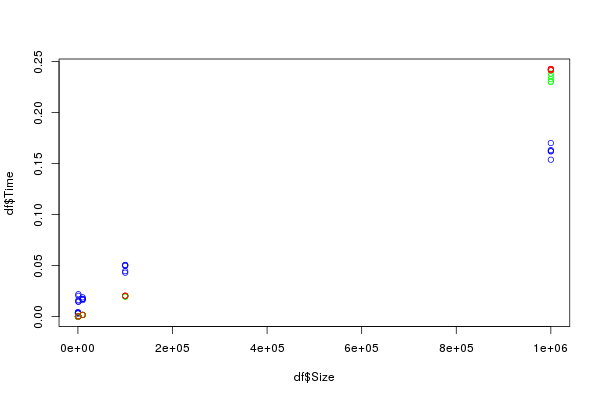

*Figure: Base R scatter plot — no legend, no axis labels, no confidence intervals.*

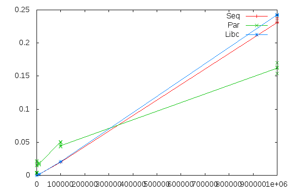

*Figure: Gnuplot line chart — lines connect averages with no uncertainty shown.*

### Original conclusion

> "A first crude analysis seems to reveal that the parallel version is worth it for arrays larger than 400,000."
> — Arnaud Legrand, journal.org, 2014-10-13

Note: this conclusion was drawn from only 5 repetitions with no confidence intervals, on a machine with more physical cores than the current one.

---

## Results — Chayma SADIKI (THREAD_LEVEL = 10) 

### Machine specifications

| Property | Value |
|---|---|
| Hostname | ensietuhp06 |
| CPU | 12th Gen Intel Core i5-1235U |
| Logical cores | 12 (2 threads/core) |
| Max CPU frequency | 4400 MHz |
| RAM | 14 GB |
| OS | Ubuntu Linux 7.0.0-38-generic (x86_64) |
| Date | 2026-10-21 |

### Performance curves (mean ± 95% CI)

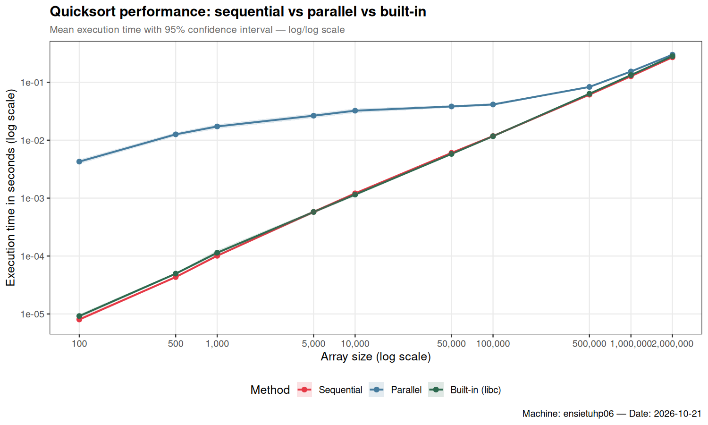

### Speedup relative to sequential (with propagated 95% CI)

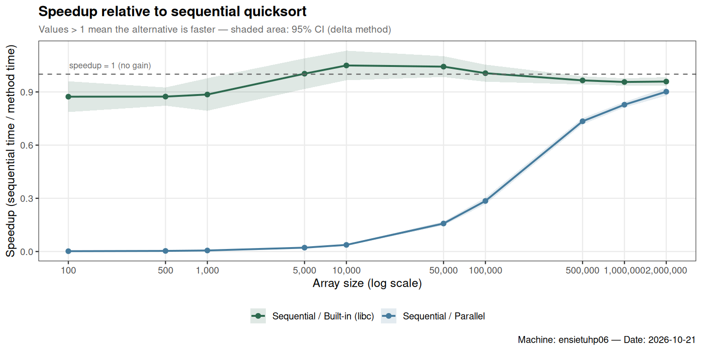

### Variability across 30 repetitions

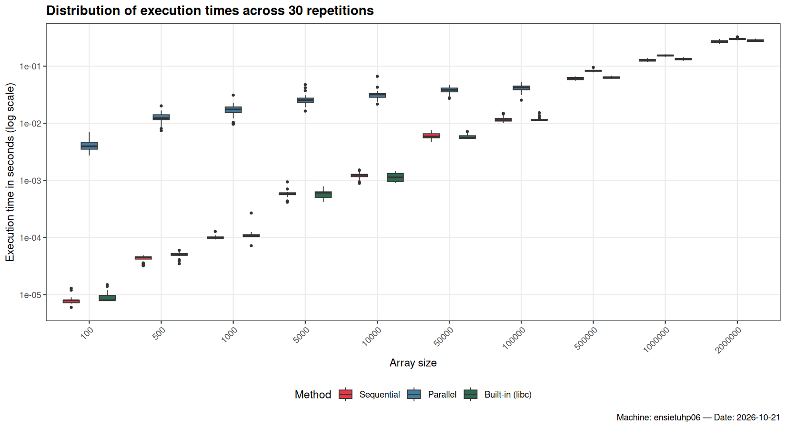

### Key observations

- The **parallel quicksort is slower than sequential for all tested sizes** on this machine. The thread creation overhead (`THREAD_LEVEL = 10` → up to 1024 threads) dominates even at 2M elements.
- The **built-in libc qsort** performs very similarly to sequential across all sizes.
- Execution times are highly **consistent across repetitions** (tight boxplots), which validates the experimental design.
- This contrasts with the 2014 results where parallel was faster at 1M — likely due to a higher core count on that machine.

---
## Results — Chayma SADIKI (THREAD_LEVEL = 3) 

### Machine specifications
 The same machine is used as in experiment with THREAD_LEVEL = 3.

### Performance curves (mean ± 95% CI)

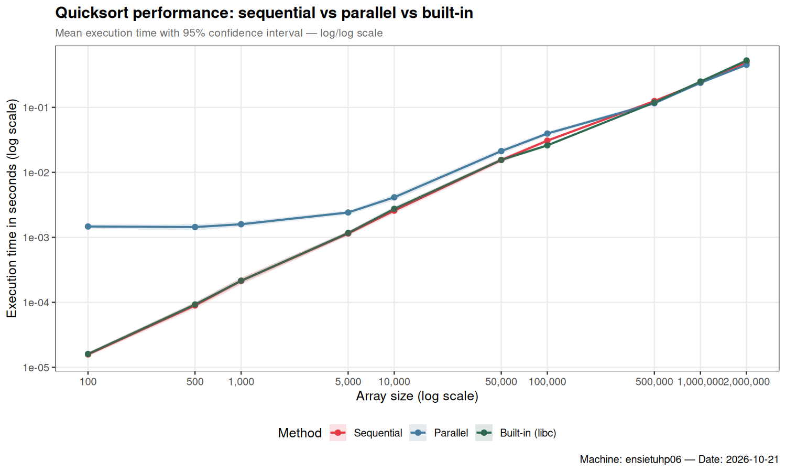

### Speedup relative to sequential (with propagated 95% CI)

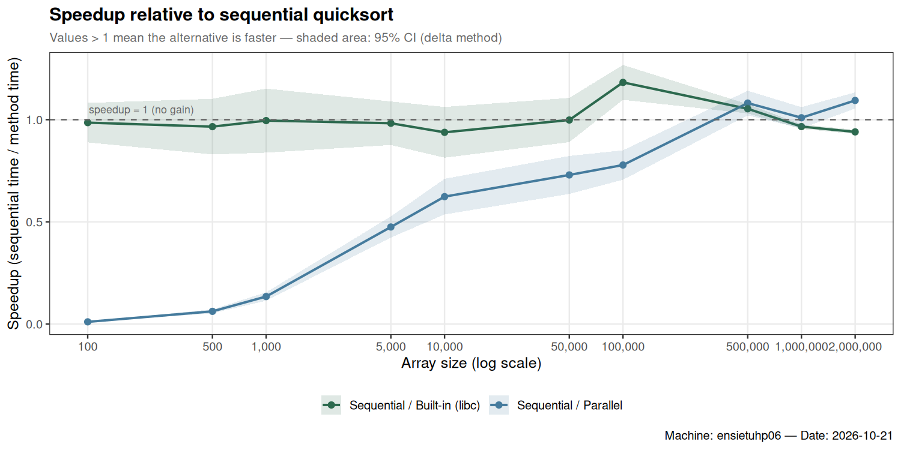

### Variability across 30 repetitions

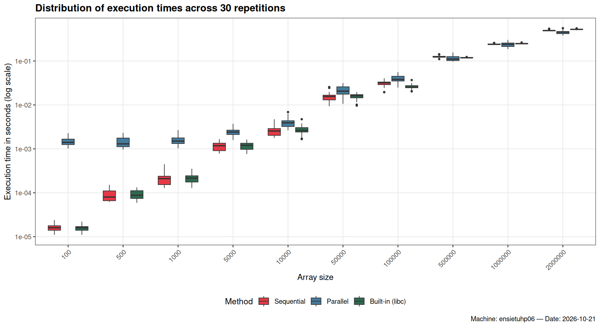

### Key observations
The idea here was to reduce the THREAD_LEVEL to 3 instead of 10 so that thread creation overhead want dominate, but the results obtained were : we gain in performance from 500000 (multithreads is faster than seq)

The size of data used was not suffisent to watch the performance for greater data sizes
we keep the same number of threads and we increase dayta sizes used 
before SIZES=(100 500 1000 5000 10000 50000 100000 500000 1000000 2000000)
after SIZES=(50000 100000 500000 1000000 2500000 5000000 7500000 10000000)

---
## Results — Chayma SADIKI (THREAD_LEVEL = 3) 

### Machine specifications
 The same machine is used as in experiment with THREAD_LEVEL = 3 and size up to 10000000.

### Performance curves (mean ± 95% CI)

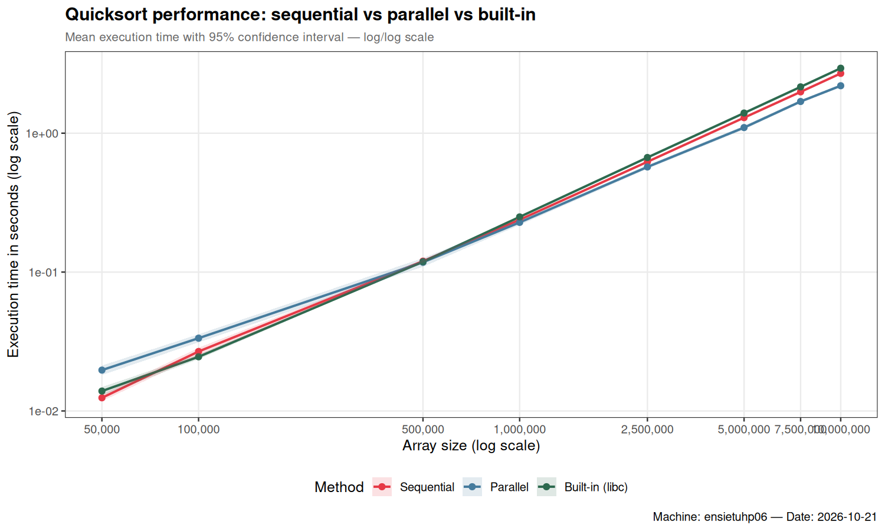

### Speedup relative to sequential (with propagated 95% CI)

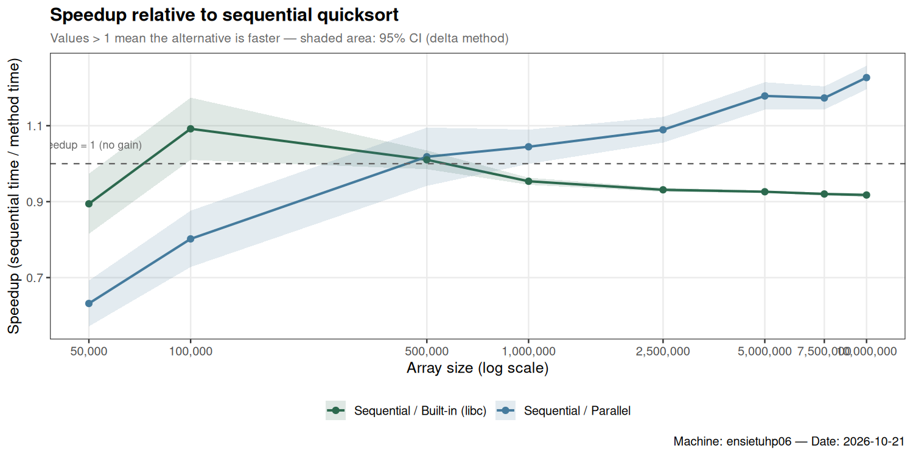

### Variability across 30 repetitions

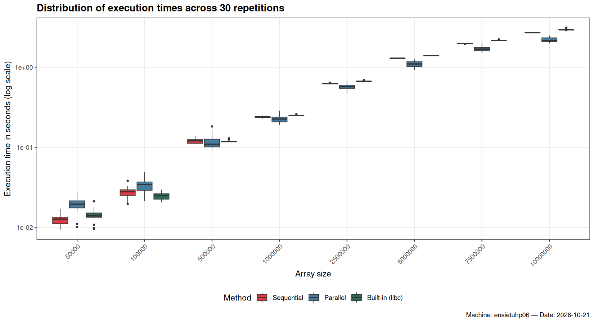

### Key observations


